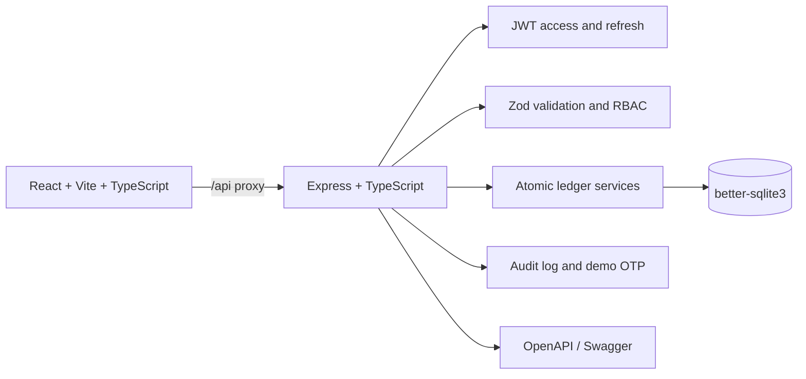
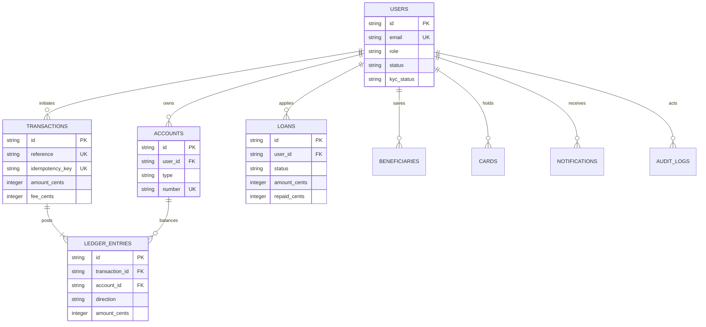

# KCB Digital Banking Demo

A responsive KCB-inspired banking prototype for management demonstrations. All balances, identities, payments, loans, cards, and OTPs are simulated locally. No real money is held or moved, and no external payment or banking integration is used.

## Run Locally

Requires Node.js 22+ and npm. In PowerShell, add the runtime to this shell's PATH if you installed Node in the user-local demo tools folder:

```powershell
$env:PATH = "$env:LOCALAPPDATA\kcb-demo-tools\node-v26.13.1-win-x64;$env:PATH"
npm run setup
npm run seed
npm test
npm run dev
```

The API listens on `http://127.0.0.1:5000`; the web app listens on `http://127.0.0.1:5173` and proxies `/api` requests to the API. Swagger UI is at `http://127.0.0.1:5000/api/docs`. Check for port conflicts with `Get-NetTCPConnection -LocalPort 5000,5173 -ErrorAction SilentlyContinue` before starting. The local SQLite database is created at `backend/data/demo.sqlite` on first API startup. Startup seeds demo data only when the database is empty.

`npm run setup` installs the root, backend, and frontend packages. `npm run seed` seeds an empty database. `npm test` runs backend invariants and auth tests. `npm run dev` starts both servers and stops them together.

## Demo Accounts

| Portal / role | Email | Password | Notes |
| --- | --- | --- | --- |
| Customer | `salim.demo@kcbbank.co.ke` | `Password123!` | Salim Kiplimo; PIN `1234` |
| Management Reviewer / Admin | `admin@kcbbank.co.ke` | `Admin123!` | Executive dashboard and demo controls |
| Teller | `teller@kcbbank.co.ke` | `Teller123!` | Lookup, KYC, cash services |
| Loan Officer | `loans@kcbbank.co.ke` | `Loan123!` | Loan decision queue |
| Sample customers | `amina.demo@kcbbank.co.ke`, `brian.demo@kcbbank.co.ke`, `grace.demo@kcbbank.co.ke`, `david.demo@kcbbank.co.ke` | `Customer123!` | Additional directory and loan data |

Use the Customer Portal or Management Portal switch on the login screen. Demo login buttons are provided for all four roles. The customer starts with Current, KCB Goal Savings, and M-Pesa Virtual accounts; opening, salary, bill, card, and transfer activity provides more than 30 transactions across the seeded customer dataset.

## Architecture





Every posted transaction balances equal debit and credit entries, including the internal clearing ledger. Customer-facing balances are derived from ledger entries in integer cents. Transfer, deposit, loan disbursement, and repayment operations are wrapped in SQLite transactions and use unique idempotency keys where a request can post money. Sensitive operations write audit records. API validation errors use `{ "error": { "code", "message" } }`.

## API Surface

- Auth: `POST /api/auth/login`, `POST /api/auth/demo-login`, `POST /api/auth/refresh`, `GET /api/auth/me`
- Customer: `GET /api/accounts`, `GET /api/transactions`, `POST /api/transfers`, `GET|POST /api/beneficiaries`, `GET /api/config/fees`
- Loans and cards: `GET /api/loans`, `POST /api/loans/apply`, `POST /api/loans/:id/repay`, `POST /api/loans/:id/review`, `GET /api/cards`, `POST /api/cards/:id/freeze`
- Customer security and updates: `GET /api/notifications`, `POST /api/notifications/:id/read`, `POST /api/security/pin`
- Teller and staff: `GET /api/staff/customers`, `POST /api/staff/deposit`, `POST /api/staff/withdraw`, `POST /api/staff/customers/:id/kyc`
- Management: `GET /api/management/overview`, `GET /api/management/transactions`, `GET /api/management/customers`, `POST /api/management/customers/:id/freeze`, `GET /api/management/audit`, `GET|PUT /api/management/settings`, `POST /api/management/reset`
- Operations and docs: `GET /api/health`, Swagger UI at `/api/docs`

## Five-Minute Presentation Walkthrough

1. Sign in with the Customer demo button. Point out the persistent simulated-data banner, total balance, three account types, cash-flow chart, and recent activity.
2. Open Transfers & payments. Send a small simulated M-Pesa payment, show the calculated fee, unique reference, and OTP toast. Try an amount above available funds to demonstrate overdraft blocking. Visit Statements to filter by reference and export CSV or print to PDF.
3. Open Loans. Move the amount and term sliders, review the amortization schedule, then submit a small instant loan to show immediate demo credit. A larger request joins the reviewer queue.
4. Sign out and use the Loan Officer demo button. Review or reject the pending sample request with a comment. Sign in as Teller to find a customer, approve KYC, or post a simulated deposit/withdrawal.
5. Sign in as Management Reviewer. Review executive KPIs, the live audit feed and flags, freeze/unfreeze a customer, change limits/fees, inspect audit events, and reset the demo dataset.

## Prototype Limitations

- All customer details and money movement are simulated. No real accounts, payment rails, credit bureau, identity verification, SMS, email, or external services are connected.
- OTPs are displayed in the UI and backend console for demonstration only. Demo credentials and JWT secrets are local defaults and are not intended for deployment.
- Loan approvals, eligibility, fees, balances, and KYC status are demonstration rules. The repayment endpoint applies principal to the simulated ledger; the calculator shows an illustrative 13% schedule.
- PDF export uses the browser print dialog. CSV export downloads the filtered mini-statement.
- This project is intentionally scoped to a local presentation prototype, not a financial system of record.
